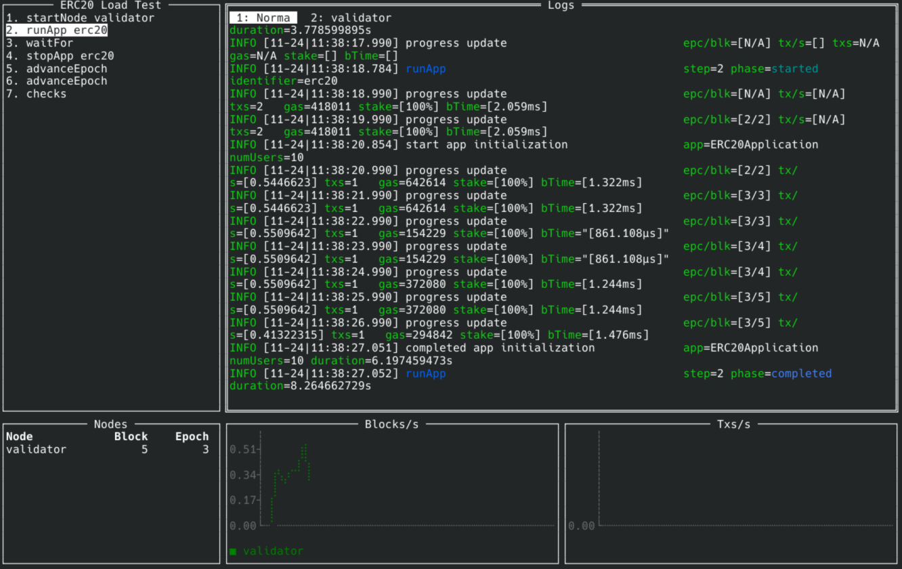

# Norma

Norma is the system testing and performance measurement tool for the
[Sonic](https://github.com/0xsoniclabs/sonic) blockchain client. It starts a
network of Sonic nodes in Docker containers, drives it through a scenario
written in YAML, generates transaction load, checks that the network behaves
correctly, and measures how it performs.

## Goals

### A testing tool

Norma checks that Sonic does the right thing in the situations that are hard to
reproduce in unit tests: many nodes, several client versions, failures and
recoveries, and changes to the network rules while it runs. A scenario can:

- start, stop, kill and restart nodes, and heal their databases;
- run validators with different stakes and client versions, and delegate and
  undelegate stake;
- change the network rules and enable upgrades mid-run;
- export and import genesis files and events between nodes;
- assert on the network with checks: blocks are produced or halted, all nodes
  agree on block hashes and heights, databases are consistent, historical state
  matches, validators are active, and more.

Unless a scenario opts out, it ends with checks that all nodes agree on the
chain. The suite in
[scenarios/release_testing](scenarios/release_testing) is run for every Sonic
release; [RELEASE_TESTING.md](RELEASE_TESTING.md) explains how it is kept up to
date. CI checks every scenario for validity and runs those a pull request adds
or changes.

### A performance measurement tool

Norma measures how the network performs under load. Load generators send
transactions to on-chain applications (counters, ERC-20 tokens, Uniswap,
bundles, smart accounts and more) at a constant, rising, wave-shaped, or
self-tuning rate. While they run, Norma records:

- block production: block times, transactions and gas per block, base fee;
- transaction throughput and latency, following every transaction from
  submission through emission to inclusion in a block;
- per-node metrics and CPU profiles.

Each run produces a CSV with all measurements and an HTML report, and runs can
be compared with each other.

## Getting started

Requirements:
- Go 1.27 or later;
- Docker 23.0 or later, with [buildx](https://docs.docker.com/reference/cli/docker/buildx/);
  your user must be able to run `docker` (see [Docker setup](#docker-setup)).

Norma is run with `go run`; there is nothing to build first. Fetch the Sonic
submodule once, then run a scenario:
```
git submodule update --init
go run ./driver/norma run scenarios/load_generators/counter.yml
```
The Docker images are built the first time they are needed: `sonic:local` from
the [sonic](sonic) submodule, pinned releases such as `sonic:v2.1.6` from their
tags, and the report renderer. `go run ./driver/norma build <file-or-dir>`
builds them ahead of time, and rebuilds the renderer after its Dockerfile
changes.

`go run ./driver/norma` lists all commands. The ones used most:

| Command | What it does |
|---|---|
| `run <file-or-dir>` | runs a scenario, or every scenario in a directory |
| `check <file>` | checks a scenario for errors without running it |
| `scenario-help` | lists all steps and their parameters |
| `run-cloud --project <p> <file-or-dir>` | runs scenarios on short-lived GCP VMs, one per node; see [Cloud runs](#cloud-runs) |
| `estimate <file-or-dir>` | estimates offline how long scenarios run and what they cost in the cloud |
| `render <measurements.csv>` | renders the report of a past run |
| `diff <measurements.csv...>` | renders a report comparing several runs |
| `build [<file-or-dir>]` | builds the client images the scenarios need, and the report renderer |
| `purge` | removes all containers and networks Norma created |

`go run ./driver/norma --sonic-path <dir> run ...` builds `sonic:local` from
another Sonic checkout instead of the submodule.

## Scenarios

A scenario is a list of steps that run one after the other:
```yaml
Name: Liveness Blackout Recovery After Quorum Loss
Description: Block production halts when quorum is lost.
Scenario:
  - startNode: validator-majority
    type: validator
    stake: 7000000
  - startNode: validator-minority
    type: validator
    stake: 3000000
  - runApp: load
    type: counter
    users: 20
    rate:
      constant: 20
  - waitFor: 20s
  - checks:
      - blocksProduced
  - stopNode: validator-majority
  - waitFor: 15s
  - checks:
      - blocksHalted
```
[SCENARIO_SPECIFICATION.md](SCENARIO_SPECIFICATION.md) describes every step,
check and network rule. The [scenarios](scenarios) directory holds:

- [examples](scenarios/examples): one feature each, a good place to start;
- [load_generators](scenarios/load_generators): one scenario per load
  generator;
- [release_testing](scenarios/release_testing): the release suite, by area
  (features, liveness, rules, stress, validators);
- [rules_upgrades](scenarios/rules_upgrades): network upgrades across client
  versions.

## Watching a run: the TUI

Add `--tui` to follow a run in the terminal:
```
go run ./driver/norma run --tui scenarios/release_testing/liveness
```



- The left column lists the scenario's steps, with the current one highlighted,
  and below them each node with its block height and epoch.
- The logs fill the right side: a `Norma` tab for the run and one tab per node.
  Switch tabs with `Tab`, `Shift+Tab` or the number keys.
- Below the logs, live plots show blocks per second for each node and
  transactions per second, sent and committed.
- `q` or `Ctrl+C` aborts the run. After the run, the TUI stays open until you
  quit it.

## Results and reports

Each run writes its results into a directory, `/tmp/norma_data_<label>_<n>` by
default (`-o <dir>` changes the parent directory, `--label` the label). The
latest run of a label is also linked as `norma_data_<label>_latest`. It
contains:

- `measurements.csv`: every measurement of the run;
- the HTML report rendered from it;
- `node_logs` and `client-logs`: the logs of every node;
- `cpu_profiles`: `pprof` CPU profiles of every node.

The report shows:
- the timeline of the scenario's steps;
- block metrics: gas, transactions, delay, base fee;
- network metrics: incoming and committed transaction rates, number of nodes;
- node metrics: block processing time, height, epoch, stakes, transaction
  pool, disk space;
- the transaction lifecycle per load generator: time per phase, transactions
  in the system, rejections, and the composition of blocks;
- application and event metrics. It is rendered with R inside Docker; no local R is
needed. `--open-report` opens it when the run ends, and
`--skip-report-rendering` skips it.

To compare runs, for instance of two client versions, pass their
`measurements.csv` files to `go run ./driver/norma diff`.

[docs/METRICS.md](docs/METRICS.md) describes the CSV format and every metric.

## Cloud runs

Small scenarios run on your machine. Larger ones, and performance
measurements that need nodes not to compete for one machine, run on
short-lived GCP VMs, one per node:
```
go run ./driver/norma run-cloud --project <project> [--tui] <file-or-dir>
```
Norma builds itself on your machine (Linux on amd64), creates a VM for every
node and one for the driver, copies the binary and your working tree to the
driver VM (including uncommitted changes, which the Sonic images are built
from), and runs `norma run --hosts` on it. The driver starts each node on a VM of its own,
which the node keeps when it restarts, and generates the load and monitors the
nodes from inside the run's network, as it would locally. Your terminal is
connected to the remote run: `--tui` shows the remote TUI, and Ctrl-C or `q`
stops the run as it would locally.

`norma run --hosts hosts.json` is the same on any machines with a Docker
daemon the driver can reach, listed as
`[{"name": ..., "ip": ..., "docker": "tcp://<ip>:2375"}]`.

Afterwards, the run's data is copied to your machine and handled as `norma run`
handles its own: `norma_data_<label>_<n>` lands in `/tmp` or in `-o <dir>`, and
the report is rendered locally unless `--skip-report-rendering` is given, and
opened with `--open-report`. `--label` and `--skip-checks` work as in `run`.

Before creating anything, `run-cloud` prints its estimate and checks that
your account has the permissions the run needs, that the region has the quota
for its VMs, and that the worst-case cost is below `--max-cost` (USD, default
5). The estimate is also available on its own, offline:
```
go run ./driver/norma estimate scenarios/release_testing/stress/multi_node_mix_payload_constant.yml
```
```
expected run:    3m8s (+10m0s setup)
nodes:           4, at most 4 at once; 3 apps
VMs:             4 × n2-standard-2 ($0.0971/h) for the nodes, n2-standard-4 ($0.1942/h) for the driver
timeout:         10m0s (VMs deleted after 40m0s)
expected cost:   $0.17
worst-case cost: $0.53
```
The number of VMs comes from the scenario's dry run: one per node, but a node
continuing from another's data volume goes to that volume's VM. The step times
are calibrated from past runs; steps listed as `uncalibrated` are guesses.
Prices are static us-central1 on-demand prices. The worst case is a hard
limit, because GCP deletes the VMs when their time runs out. Other flags:
- `--zone`: default `us-central1-a`.
- `--machine-type`: the node VMs, default `n2-standard-2`.
- `--driver-machine-type`: default sized by the number of nodes.
- `--timeout`: default twice the estimated duration.

Each run gets a network of its own: a VPC, subnet, firewall rules and Cloud
NAT, all named `norma-run-<run-id>`. Only the driver VM accepts SSH, through
IAP; the nodes' Docker daemons, which have no TLS, accept only the driver VM.
No VM has a public IP, and nothing else in the project shares their network,
so runs neither touch other VMs nor each other. Every VM keeps Docker and its
data on a local NVMe SSD, which disappears with the VM. The resources are declared in
[driver/cloud/main.tf](driver/cloud/main.tf); each run keeps its Terraform
state and logs in `cloud-runs/<run-id>/`.

Everything a run creates is deleted, however it ends:
- On success, failure, Ctrl-C or SIGTERM, Norma collects the results, destroys
  the VMs and their network, and checks that none of them is left. It fails
  loudly if something is. Further interrupts cannot stop the teardown.
- If Norma itself is killed, GCP deletes the VMs and their disks once the timeout
  plus 30 minutes have passed. The network is left; it costs next to nothing
  but counts against the project's quota of VPC networks (15 by default).
  Remove it with `terraform -chdir=cloud-runs/<run-id>/tf destroy`.

Requirements:
- `terraform` and `gcloud`;
- two logins: `gcloud auth login` for SSH, and
  `gcloud auth application-default login` for Terraform;
- the Compute Engine and IAP APIs enabled in the project
  (`gcloud services enable compute.googleapis.com iap.googleapis.com`);
- the roles Compute Admin (or Editor) and IAP-secured Tunnel User in the
  project.

Use a project with a billing budget alert.

## Development

```
make test                       # all tests
go test ./driver/...            # a part of them
```

Optional tools:
- `make generate-mocks` needs `mockgen`:
  `go install go.uber.org/mock/mockgen@latest`, with `$HOME/go/bin` in your `PATH`.
- `make generate-abi` needs [solc 0.8.19](https://github.com/ethereum/solidity/releases/tag/v0.8.19)
  and go-ethereum's `abigen`.

New load generators live in [load/app](load/app) and register themselves by
name; new steps live in [driver/steps](driver/steps).

### Docker setup

On Linux, if `docker images` fails with a permission error, add your user to
the `docker` group and log in again:
```
sudo usermod -aG docker $USER
```
On macOS, if Norma cannot reach `unix:///var/run/docker.sock`, either enable
*Settings → Advanced → Allow the default Docker socket* in Docker Desktop, or
point Norma at Docker Desktop's socket:
```
export DOCKER_HOST=unix://$HOME/.docker/run/docker.sock
```
`go run ./driver/norma purge` removes everything Norma left behind, for
instance after an aborted run.
